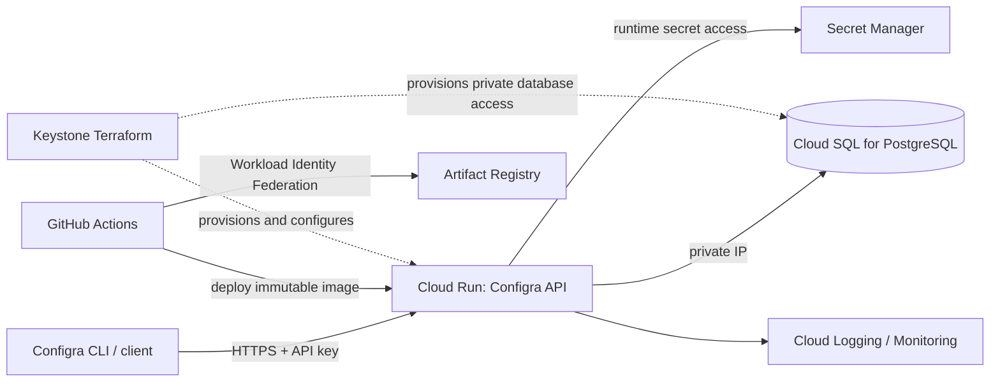

# Configra + Keystone Implementation Plan

## Goal

Run a real, non-production Configra deployment on GCP with Keystone managing the infrastructure and deployment path. Demonstrate an end-to-end result: deploy the Go API, persist configuration versions in PostgreSQL, validate a configuration, roll back to a prior version, and show the health, security, recovery, and cost signals needed to operate it.

This is a staged plan, not approval to create GCP resources. No infrastructure should be applied until the project, billing owner, budget limit, region, and exact Terraform plan are reviewed.

## Current implementation status

Keystone's dev environment now builds the Configra image from the separate `clyvecute/configra` repository, records the exact Configra source commit as a build artifact, and deploys that immutable tag. Cloud Run receives the Cloud SQL host/port/user/database/TLS mode from Terraform and the database password plus Configra bootstrap API key from Secret Manager. Configra uses the bootstrap key to replace the local demo key on the seeded default project. The deploy workflow checks both `/health` and `/ready`.

To deploy a Configra change after it is merged, run Keystone's **Build** workflow manually and provide its Configra branch/tag/commit in `configra_ref`; the successful Build run triggers Keystone's dev deploy and carries the exact source SHA. Keystone pushes to `main` also build Configra `main` and trigger the dev deploy. Review the Terraform plan and cost estimate before the first apply. This only wires the dev pilot; production is deliberately unchanged.

Terraform's generated bootstrap key is marked sensitive and is not an output, but Terraform state includes secret material. Restrict the dev GCS state bucket to the smallest operator/deployer group and keep state access audited.

After Terraform applies, `terraform output -raw service_url` returns the Configra API base URL and `terraform output -raw configra_api_key_secret_id` returns the Secret Manager ID containing the client key. A Keystone-hosted client should receive those values as `CONFIGRA_BASE_URL` and `CONFIGRA_API_KEY` at runtime; grant its runtime service account `roles/secretmanager.secretAccessor` on that one key secret. Keep the key server-side. API calls use `X-API-Key` and the environment ID configured in Configra.

## Why Configra fits

Configra already has a Go HTTP API, a container build, PostgreSQL migrations, a Docker Compose setup, and a GCP deployment directory. Its stack maps naturally to Keystone's Cloud Run and Cloud SQL components. The integration should make Keystone the **single owner of GCP infrastructure** so the two Terraform stacks do not attempt to manage duplicate resources.

Relevant current files:

- Configra API: `cmd/api/main.go`
- Configra runtime configuration: `internal/config/env.go`
- Database connection and retry: `internal/db/db.go`
- Container: `Dockerfile`
- Existing cloud Terraform: `deploy/gcp/main.tf`
- Keystone dev environment: `terraform/environments/dev/main.tf`
- Keystone Cloud Run module: `terraform/modules/compute/main.tf`
- Keystone database module: `terraform/modules/database/main.tf`
- Keystone deployment workflow: `.github/workflows/deploy.yml`

## Target architecture

### Ownership boundary

- Keystone owns the GCP service, database, network connectivity, IAM, secret bindings, monitoring, and remote Terraform state for the pilot.
- Configra owns application source, API behavior, migrations, container definition, and database schema.
- Configra's current `deploy/gcp` stack must not be applied to the same resources once Keystone owns them. Retire it, or clearly mark it as a non-authoritative example before adoption. Do not import or delete existing cloud resources until inventory and Terraform state ownership are understood.
- Start with an isolated **staging GCP project** and empty database. Do not point the pilot at production data or migrate any existing database.

## Important implementation gaps and safety decisions

Resolve these before first cloud apply:

1. **Existing Terraform is unsafe as the target design.** Configra's current GCP file enables a public Cloud SQL IP, sends the DB password as a plain Cloud Run environment value, allows `allUsers` invocation, and disables deletion protection. Reuse neither those settings nor that stack as-is.
2. **Keystone's full environment may provision more than this pilot needs.** Review the plan for Cloud SQL sizing, VPC connector, KMS, logging sinks, monitoring, and any minimum instances. Remove or make unrelated resources optional in a dedicated Configra environment before applying; don't quietly inherit costs.
3. **Do not publish a configuration-management API as unauthenticated.** Keep Cloud Run public invocation only if required by clients, but enforce Configra API-key authentication at the application layer for every sensitive endpoint. `/v1/validate` and `/fetch` also need explicit abuse/access policy. Prefer authenticated access unless public validation is a deliberate product feature with limits.
4. **Use private database connectivity.** Cloud SQL should have no public IP for this pilot; Cloud Run must have the intended private path. The database password belongs in Secret Manager, granted only to the Cloud Run runtime identity. Do not commit secrets or put secret values in Terraform variables/state output.
5. **Handle migrations deliberately.** `cmd/api/main.go` currently runs migrations on service startup and logs migration failure without stopping. With multiple Cloud Run instances/revisions, startup migrations can race or allow an unhealthy release. Introduce a one-shot migration job or otherwise serialize migrations, fail deployment on migration errors, and document forward/rollback compatibility.
6. **Make database startup failure explicit.** The API currently logs a warning and continues if PostgreSQL is unreachable, while database-backed endpoints may then be unusable. Define readiness so an instance is not considered ready without its required dependency; keep `/health` semantics clear (liveness versus readiness).
7. **Review default credentials and CORS.** `internal/config/env.go` has local-friendly defaults including `DB_SSLMODE=disable`; production must use TLS as appropriate and fail closed on missing required settings. Review CORS in `internal/middleware/cors.go` and allow only expected origins if browser access is supported.
8. **Check secret exposure paths.** Ensure Terraform state and plans are protected, outputs redact secret data, logs never print credentials/config contents, and GitHub uses Workload Identity Federation without long-lived service-account keys.

## Work phases

### Phase 0 — discovery and cloud boundary (no cloud changes)

- Inspect Configra's complete API/auth, migration, config-fetch, and CLI behavior. Confirm the intended client, who owns API keys, and whether the service is a demo or a production candidate.
- Inventory any existing GCP projects, resources, Terraform state, DNS, API keys, and deployed Configra copies. Establish whether there is any data to preserve; default to a new empty staging database.
- Choose a staging project, region, owner, spend-alert threshold, log retention, and deletion policy.
- Decide the canonical endpoint and whether API-key rotation/revocation is needed for the pilot.
- Review the Keystone module contracts and prepare an isolated Configra environment that contains only approved resources.

**Gate:** do not proceed until the target project is known, resource ownership is clear, budget alerts are configured or approved, and there is no conflict between Terraform states.

### Phase 1 — application readiness

- Make the server fail startup on invalid required production configuration and database connection/migration failures.
- Separate liveness from readiness. Readiness must reflect whether the API can serve database-backed requests.
- Move schema migrations to a serialized release step or one-shot job; use backward-compatible migration order for rolling Cloud Run revisions.
- Enforce authentication/authorization and request limits on all routes, including `/fetch`; set CORS intentionally.
- Configure TLS to the database, bounded DB pool size/timeouts, graceful HTTP shutdown, request timeouts, and structured logs with request IDs.
- Ensure secrets are read at runtime through Secret Manager integration; never bake them into the image.
- Pin the container base image and build a non-root, minimal runtime image with a deterministic build process. Keep the service listening on Cloud Run's `PORT`.

**Gate:** local CI/build succeeds; API route and migration behavior are documented; security review confirms routes and secrets have explicit policies.

### Phase 2 — Keystone infrastructure slice

- Create a dedicated `configra-staging` environment or equivalent isolated state, reusing reviewed Keystone modules where they fit.
- Provision only required APIs, Artifact Registry, Cloud Run, Cloud SQL PostgreSQL, private connectivity, runtime/deployer service accounts, Secret Manager secret container and IAM binding, logs, and minimal alerts.
- Use a private Cloud SQL address and private connectivity. Restrict egress/ingress to what Configra actually needs.
- Set conservative initial Cloud Run min/max instances and concurrency based on a small staging workload, not on unmeasured README claims.
- Configure Cloud SQL backup and deletion protection appropriate to staging and its data value. Keep production HA as a separate decision.
- Run `terraform fmt`, `terraform validate`, module tests and security scans. Generate and inspect the complete plan and cost estimate.

**Gate:** plan review verifies every resource, region, IAM grant, ingress setting, database exposure, deletion behavior, and estimated recurring cost. No apply if the plan includes unrelated resources or unexpected deletes/replacements.

### Phase 3 — build and deploy pipeline

- Build the Configra image from the Configra repository with a unique immutable commit SHA tag.
- Scan dependencies and image; publish to Artifact Registry using GitHub Actions Workload Identity Federation.
- Deploy to Cloud Run using a dedicated deploy identity with only required permissions; keep runtime identity separate.
- Run database migration as a controlled release step, then deploy the new Cloud Run revision.
- Require deployment checks and smoke tests; missing cloud auth must yield a visibly skipped/failed deployment, never a misleading green success.
- Keep an explicit rollback method for the Cloud Run revision. Database schema rollback must follow the migration plan, not assume reverting the image reverses DDL.

**Gate:** a staging commit can build, scan, deploy, pass smoke checks, and roll back without long-lived cloud credentials.

### Phase 4 — end-to-end pilot and measurable results

Use a disposable staging project/database and test data. Demonstrate:

1. `GET /health` and readiness report correct states when healthy and when the database is intentionally unavailable.
2. An unauthenticated request to protected endpoints is rejected; a valid API key can create or fetch only the permitted configuration.
3. Schema-invalid configuration is rejected without creating a version.
4. Valid configuration is saved as an immutable version and can be fetched after a new Cloud Run revision deploys.
5. Rollback selects the intended previous version and the API returns that version afterwards.
6. Invalid DB credentials or unreachable DB cause a clear readiness/deployment failure without exposing secret values.
7. Logs and alerts show request count, latency, error rate, instance scaling, and database connection health without storing config payloads or API keys.
8. A modest load profile records achieved throughput, p50/p95 latency, error rate, Cloud Run instance count, DB connections, and estimated/actual cost for the test period.

Set numerical SLO/load targets with the project owner before testing. Do not claim “millions of requests per day” or production capacity from Terraform scaling limits alone. The workload, query mix, DB sizing, and measured tests determine capacity.

**Gate:** publish a short evidence report containing commit/image digest, Terraform plan/apply reference, smoke-test results, load profile, measured latency/errors, resource usage, cost observed, and limitations.

### Phase 5 — production decision (separate approval)

- Decide whether Configra has a real production use case, data classification, user onboarding, backup/restore objective, on-call owner, and incident procedure.
- Review API-key storage, creation, rotation, revocation, and audit attribution before accepting external tenants.
- Run a restore rehearsal and document recovery time/data-loss measurements.
- Perform larger, controlled load tests and tune Cloud Run concurrency, max instances, DB pool size, and database tier together.
- Decide whether regional HA, load balancer/Cloud Armor, Binary Authorization, longer audit retention, or multi-region architecture is justified by requirements and budget.
- Approve any production project/resources separately. Staging success is not production approval or compliance certification.

## Expected deliverables

- A Configra integration environment in Keystone with isolated Terraform state.
- A reviewed Cloud Run + private Cloud SQL deployment and least-privilege IAM/secret setup.
- Secure, reproducible build/deploy pipeline using image digests and Workload Identity Federation.
- Migration/readiness behavior suitable for Cloud Run revisions.
- Smoke, recovery, and measured load evidence for the stated staging target.
- A cost summary, operations notes, rollback procedure, and candid list of remaining production gaps.

## Cost controls

- Require an Infracost estimate and human-reviewed Terraform plan before apply.
- Use an isolated staging project, small initial DB tier, scale-to-zero/minimal Cloud Run capacity, short test windows, and explicit cleanup procedure after the pilot.
- Keep budget alerts and inspect actual billing after apply; alerts notify but are not hard spending caps.
- Treat Cloud SQL, VPC connectivity, logging sinks/retention, Artifact Registry storage, and any warm Cloud Run instances as possible recurring charges. Avoid optional load balancer, Cloud Armor, BigQuery audit sink, Redis, and multi-region resources until requirements justify them.
- Never run destructive cleanup until the exact project, state, resource list, and data-retention requirement have been confirmed.

## Rollback and recovery

- **Application release:** route traffic back to the prior healthy Cloud Run revision. Keep the previously deployed image digest available.
- **Schema:** migrations should be additive/backward compatible during rollout. Use a documented corrective migration for destructive or incompatible changes; do not assume application rollback reverses schema changes.
- **Infrastructure:** revert the reviewed Terraform change and inspect the plan before applying. Preserve state and backups; don't destroy Cloud SQL as a rollback shortcut.
- **Credentials:** revoke/rotate the affected Configra API key or Gemini/Sentinel integration secrets as applicable, then verify the replacement through Secret Manager.
- **Database recovery:** rehearse Cloud SQL restore from backup into a separate instance before claiming recovery readiness; record actual recovery time and data loss.

## Definition of done for the pilot

- Keystone is the only Terraform state managing pilot resources.
- No public Cloud SQL IP, plaintext database password in Terraform-managed runtime environment, or unintended unauthenticated write/fetch route exists.
- A tested Configra workflow (validate → write version → fetch → rollback) works end-to-end on staging.
- CI deploy is reproducible and keyless; health/readiness, logs, alerts, and rollback are demonstrated.
- Terraform resources and actual cost are documented, and capacity claims match measured results.
- No production migration or scale claim is made without separate evidence and approval.
