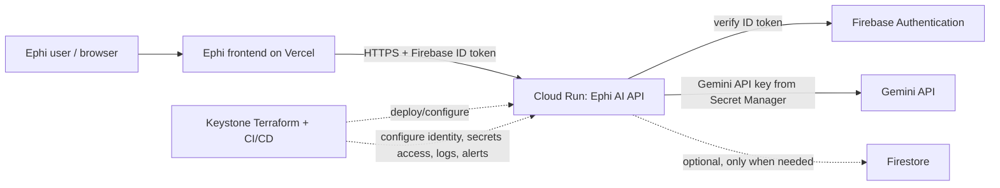

# Ephi + Keystone Integration Preparation

## Purpose and status

This document prepares a possible Ephi integration with Keystone. It describes the target boundaries, expected service behavior, prerequisites, risks, and rollout checks. **It does not deploy infrastructure or change Ephi.** The first proposed integration is intentionally narrow: move Ephi's Gemini `generateReading` API from Firebase Cloud Functions to a Cloud Run service managed with Keystone, while keeping the existing frontend, Firebase Authentication, and Firestore in place.

Treat the deployment as a proposal until Ephi's owner confirms the GCP project, billing limits, required user flows, and production readiness. Do not run Keystone's current full development environment for this pilot without reviewing its plan: it provisions Cloud SQL and networking that this API-only integration does not need.

## Proposed architecture

### Keep in Ephi

- React/Vite frontend and Vercel hosting.
- Firebase Authentication as the identity provider.
- Firestore as the existing application database and source of truth.
- Existing user and credit/business rules, after confirming where they are implemented.

### Proposed Keystone-managed scope

- One Cloud Run HTTP service for the Gemini proxy.
- A dedicated runtime service account with least-privilege access.
- Secret Manager access for the Gemini API key; no key in source, image, browser bundle, or Terraform state values.
- Workload Identity Federation for GitHub Actions deployment, plus Artifact Registry for the built image.
- Cloud Logging and a small set of actionable Cloud Monitoring alerts.
- Optional Cloud Armor/load balancer only if the threat model or measured traffic warrants the added components and cost.

Do not provision Cloud SQL, Redis/Memorystore, Pub/Sub, a VPC connector, or multi-region routing for the initial API-only pilot unless a measured Ephi requirement justifies each one. Firestore remains the database. Add services only after documenting their use and cost.

## Expected API behavior

Preserve the existing client contract during migration unless Ephi intentionally versions it:

| Item | Expected behavior |
| --- | --- |
| Operation | Generate an AI reading from a text prompt, optionally using an uploaded file reference. |
| Authentication | Require `Authorization: Bearer <Firebase ID token>` and verify it server-side with Firebase Admin SDK. Reject missing, malformed, expired, or invalid tokens with HTTP 401. |
| Input | Accept a JSON object with a non-empty prompt and, when supported, an optional validated `fileUri`. The model should be selected from a server-side allowlist/default, not accepted as an unrestricted client choice. |
| Success | Return the Gemini result in the response format the current Ephi client expects. |
| Client errors | Return stable 4xx responses for invalid JSON, missing/oversized prompt, unsupported model, invalid file reference, or unsupported HTTP method. |
| Upstream errors | Return a sanitized, stable error response. Do not expose Gemini credentials, raw upstream internals, or stack traces to clients. Log a request/correlation ID and safe diagnostic details. |
| CORS | Allow only the production Ephi origin(s) and any explicitly approved preview origins. Support preflight OPTIONS if the browser calls Cloud Run directly. |
| Runtime | Listen on the Cloud Run-provided `PORT` (default 8080), handle graceful shutdown, and set bounded request/upstream timeouts. |
| Health | Provide a lightweight health/readiness endpoint that does not reveal secrets or require a Gemini call. |

The existing implementation is in [Ephi `functions/index.js`](../../Ephi/functions/index.js) on this machine. It currently verifies a Firebase token, accepts a caller-provided model, permits broad CORS origins, reads the Gemini key from Firebase Functions config or an environment variable, and forwards upstream error text. Confirm which of these behaviors Ephi's frontend depends on before changing them. The `fileUri` path also needs ownership/access validation appropriate to how Ephi uploads files.

## Expected functions and responsibilities

1. **HTTP entry point**: accept the existing API request, enforce method/content type/body-size limits, and produce compatible responses.
2. **Authentication**: verify Firebase ID tokens through Firebase Admin SDK using Application Default Credentials; never trust a user ID supplied in the request body.
3. **Authorization and quotas**: enforce Ephi's per-user access, subscription/credit, and abuse rules before calling Gemini. Identify the current source of truth for these rules; do not assume token authentication alone authorizes paid usage.
4. **Request validation**: validate prompt length, model allowlist, file URI ownership and MIME type, and any other user-controlled fields.
5. **Gemini adapter**: read the API key from Secret Manager at runtime or through a protected Cloud Run secret binding; apply bounded timeout/retry behavior and return a stable client response.
6. **Operational signals**: emit structured logs with request ID, latency, status, authenticated user identifier only in a privacy-conscious form, and upstream status. Never log prompts, tokens, uploaded content, or secrets by default.
7. **Deployment**: build and scan an immutable container, push it to Artifact Registry, deploy via GitHub Actions using Workload Identity Federation, and retain a rollback path to the previous Cloud Run revision / Firebase function.

## Integration prerequisites

- Ephi owner identifies the correct GCP/Firebase project and confirms billing, region, data residency needs, and a spending/alert budget.
- Confirm the frontend API URL and call sites, including whether Ephi currently calls a Firebase function URL directly or through a Vercel route. Inspect [Ephi `vercel.json`](../../Ephi/vercel.json) and the frontend before selecting direct browser-to-Cloud-Run versus a Vercel proxy.
- Confirm Firebase Authentication and Firestore remain authoritative. Grant the Cloud Run runtime identity only the Firebase permissions it needs; do not use downloaded service-account key files.
- Inventory the current Firebase function configuration and rotate the Gemini key if it has ever been committed, logged, or exposed to a client.
- Add a container build definition and a Cloud Run-compatible HTTP server; Firebase's `functions.https.onRequest` wrapper cannot simply be run as a normal Cloud Run container without an adapter.
- Configure API enablement, Artifact Registry, runtime service account, Secret Manager binding, Cloud Run service, IAM, and observability as a minimal Terraform slice. Review Keystone's current [Cloud Run module](../terraform/modules/compute/main.tf), environment composition, and deployment workflow for assumptions before reusing them.
- Make CI report missing cloud credentials as a skipped deployment, not as evidence of a successful deploy. Require an actual deployment and smoke test in the intended environment before calling the integration live.

## Cost and operational catches

- Cloud Run may scale down when idle, but requests, CPU/memory allocation, outbound Gemini usage, artifact storage, logs, and any always-on/minimum instances can incur charges. Set budget alerts and Gemini/API quotas before production traffic.
- Reusing Keystone's current full environment can create baseline costs for Cloud SQL and networking even though this service does not need them. Use a targeted plan and verify every resource before applying.
- A direct browser call to Cloud Run requires carefully configured CORS and an app-level Firebase bearer-token check. Cloud Run IAM-only private invocation is not suitable for an untrusted browser client unless a trusted server-side proxy invokes it.
- Firebase Admin SDK verification and Firestore access must work from the selected GCP project and service identity. Cross-project IAM and project selection mistakes can block requests or grant too much access.
- Moving the API changes its runtime, deployment path, error handling, scaling behavior, and logs. It does not automatically make Gemini faster or cheaper; measure latency, failure rate, and per-user usage.
- Multi-region deployment, Redis, Cloud SQL, and Pub/Sub add operational surface and cost. They are later options, not prerequisites for a credible pilot.

## Rollout plan and acceptance checks

### Phase 0 — inventory, no infrastructure changes

- Record current endpoint URL, request/response examples, Firebase function runtime/config, frontend call sites, auth rules, credit checks, file upload flow, and current traffic.
- Decide whether the first deployment is a staging-only API or a production canary.
- Agree on allowed origins, region, budget alerts, log retention, and rollback owner.

**Accept when:** the owner can describe the existing user flow and the new service's project, identity, API contract, and cost boundary.

### Phase 1 — prepare the service and infrastructure

- Implement a containerized HTTP adapter with the contract above.
- Create only the required Cloud Run, Artifact Registry, service identity, secret access, and monitoring resources through a reviewed Terraform plan.
- Build and scan the image in CI; use Workload Identity Federation rather than long-lived cloud keys.

**Accept when:** Terraform plan contains only approved resources; no Gemini key or Firebase service-account key is present in code, image layers, logs, or plan output; and CI can deploy to a non-production environment.

### Phase 2 — staging verification

- Verify valid Firebase token succeeds and missing, invalid, expired, or unauthorized tokens fail safely.
- Verify malformed/oversized requests, unsupported models, invalid file references, CORS preflight, upstream throttling, and timeouts return controlled responses.
- Verify existing Firestore records and user/credit rules are unchanged.
- Run a smoke test through the same route the frontend will use; compare response shape against the current function.
- Review logs, alert delivery, request latency, scaling, and actual cloud/Gemini charges.

**Accept when:** Ephi's critical user flow works end-to-end in staging, security checks pass, and the owner accepts measured cost and operations.

### Phase 3 — controlled production cutover

- Deploy a revision and route a small canary or staging-only audience first.
- Monitor 401/403/4xx/5xx rates, Gemini errors, latency, instance scaling, and budget signals.
- Keep the Firebase function deployable during the agreed rollback window. Roll back routing if auth, response compatibility, cost, or error rate regresses.
- Remove the old function only after the new endpoint has met the agreed observation period and rollback is no longer needed.

**Accept when:** the owner confirms the live endpoint, monitoring, rollback plan, and any old-function retirement.

## Decisions to record before implementation

1. Is the goal a low-risk Keystone showcase, lower operational cost, or production scale? These lead to different designs.
2. Should the browser call Cloud Run directly, or should Vercel proxy requests to it?
3. Where do Ephi's credit/subscription and file ownership checks live today?
4. Which Firebase project and GCP region are approved, and what monthly budget/alert threshold should block rollout?
5. What response/error contract and latency/error targets must remain compatible?

## Recommendation

Start with a staging-only migration of `generateReading`, keep Vercel, Firebase Authentication, and Firestore unchanged, and use a minimal Keystone-managed Cloud Run deployment. Do not migrate the database or apply the full Keystone development stack for this pilot. If the function is already reliable and Cloud Run does not solve a real need, Keystone can still demonstrate value through security scanning, deployment policy, and operational documentation without moving Ephi's runtime.
